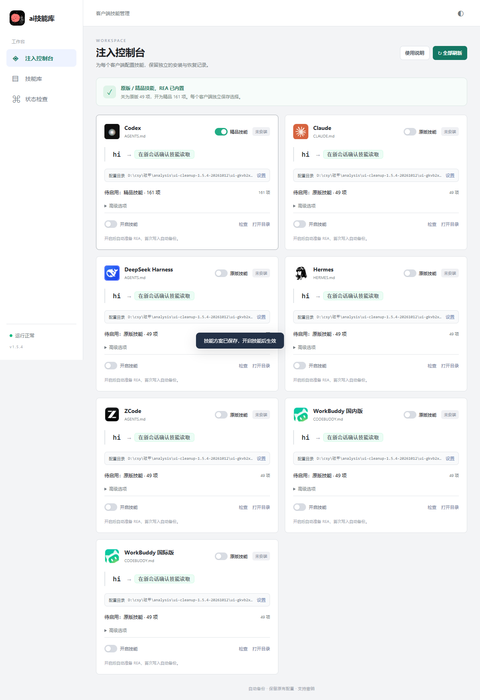

# ai技能库

**AI 开发 · 程序版本 1.5.5**

Windows 桌面 AI 技能管理工具，支持技能安装、切换、导入、备份、检查与撤销。支持 Codex、Claude、DeepSeek Harness、Hermes、ZCode，以及 WorkBuddy 国内版和国际版。

原版与精品是两套独立方案：原版 49 项、精品 161 项，均包含可用正文。共用 REA 工具不计入这两项数量。

## 下载与使用

从 [1.5.5 发布页面](https://github.com/Lin6932271/ai-skill-library/releases/tag/v1.5.5)下载 Windows EXE，或解压便携 ZIP 后运行 `ai技能库.exe`。需要 Windows x64 和 Microsoft Edge WebView2 Runtime，无需安装 Python。

1. 确认客户端配置目录。
2. 上方方案开关关闭为原版技能，开启为精品技能；七个客户端各自保存选择。
3. 开启下方技能开关，等待自动准备 REA 并完成安装。
4. 点击“检查”，随后完全退出并重新打开 AI 客户端，在新会话中描述任务并加上“使用技能”。

已有安装显示“更新当前方案”时，点击即可检查冲突、备份并更新。已安装状态下切换方案也会先检查并备份；关闭下方开关可以撤销程序管理的内容。

1.5.4 的控制台仅显示方案与数量，顶部及客户端卡片已清理正文获取状态提示。技能库页面仍会明确标识不可用项目。

导入格式、客户端目录和备份操作见[使用说明](docs/USAGE.md)。

## REA 与验证范围

REA 6.1.0 和 Node 24.19.0 已内置，首次安装无需联网下载这些组件或手动填写 MCP。首次释放和检查可能需要数分钟。

文件写入、独立 CLI/MCP 启动和实际 AI 会话连接分别确认。EXE/DLL 深度反编译需要 IDA/Ghidra；其他专项工具及附件也要在使用环境中核对。

1.5.5 补齐 14 项精品正文，完整精品目录与可部署正文均为 161 项。构建与验收结果见[版本说明与验收报告](docs/2026-10-13_release-ai-skill-library-1.5.5-report.md)。

[更新记录](docs/CHANGELOG.md) · [1.5.5 升级说明](docs/UPGRADE_1_5_5.md) · [源码构建](docs/BUILD.md) · [REA 集成与验收](docs/REA_INTEGRATION.md) · [兼容性修复](docs/REA_COMPATIBILITY.md)

## 致谢

感谢 QQ 2608422753 这位好友参与测试，帮助发现并验证修复 DeepSeek Harness 的 REA 兼容问题。

## 注意事项

- 写入前自动备份，遇到外部修改会保留文件并提示冲突。
- 技能里的工具和附件说明不代表相应工具已经安装或验证。
- 第三方组件遵循各自许可证，见 [NOTICE.md](NOTICE.md)。
- [1.5.5 逆向与安全报告](docs/security/REVERSE_ANALYSIS.md)包含新版检查结果及 6 个 npm 附带组件的公开漏洞版本匹配记录；真实可利用性未确认。[1.3.2 历史报告](docs/security/REVERSE_ANALYSIS-1.3.2.md)和历史发行版继续保留。
